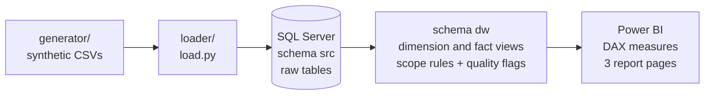
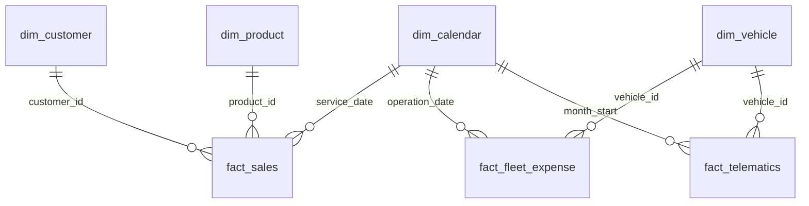
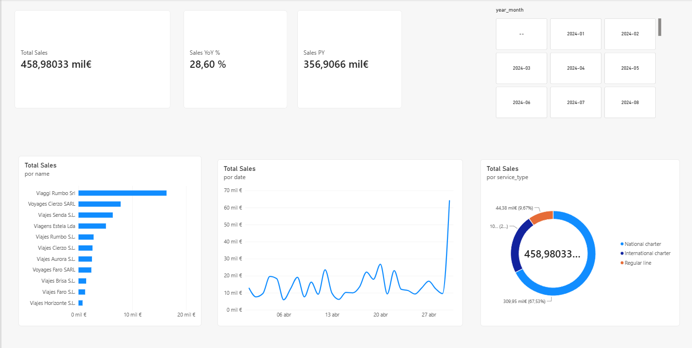
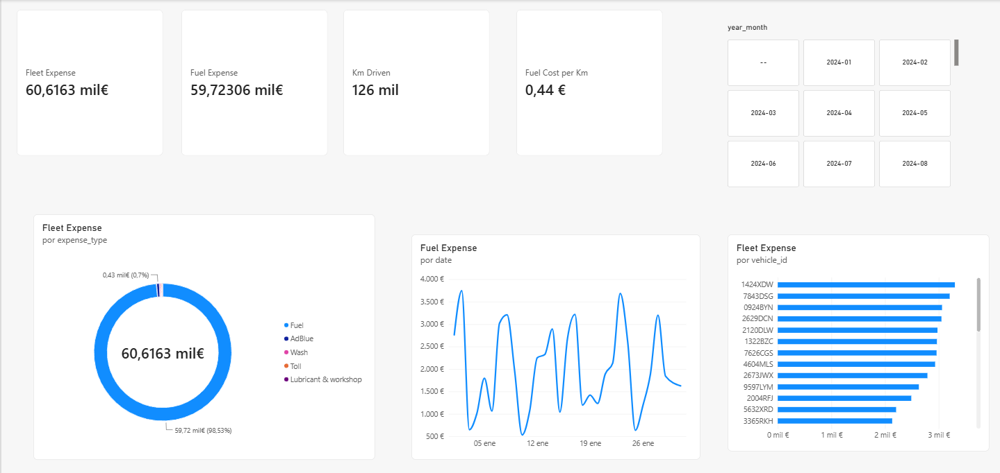
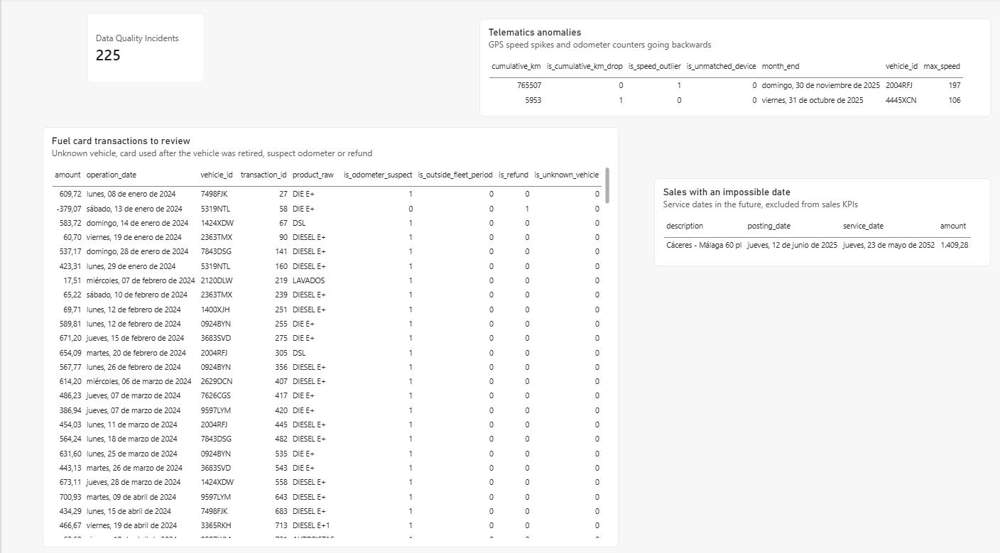

# Passenger Transport Analytics

**SQL Server star schema and Power BI report for a coach company: sales, fleet costs and data quality.**

> **All data in this repository is synthetic** and generated by the included scripts.
> The project is inspired by a real consulting engagement for a passenger transport company,
> but contains no client data, names, schemas or figures: the source schema and the dataset
> were created from scratch. The real data cannot be published for confidentiality reasons.

## What this is

An analytics layer built on top of source systems that were never designed for analytics:

- a **generic ERP** that records every coach service as a line of a sales delivery note,
  mixed with test companies, commissions, rentals and used-vehicle sales;
- a **fuel-card provider export** with integer dates, free-text product names and refunds;
- a **telematics export** with monthly kilometres per vehicle, and a fleet register.

The goal is the same one as in the real project: give the business its own reporting,
independent of the ERP vendor, and make data problems visible instead of hiding them.

## Architecture



## Data model



| View | Grain | Notes |
| --- | --- | --- |
| `dw.fact_sales` | one service line | scope rules for company, accounting group and vehicle sales; business date = service date |
| `dw.fact_fleet_expense` | one fuel-card transaction | free-text products mapped to Fuel, AdBlue, Toll, Wash, Lubricant & workshop |
| `dw.fact_telematics` | one vehicle and month | kilometres, speeds, counter checks |
| `dw.dim_calendar` | one day | generated 2024-2027 |
| `dw.dim_customer` | one customer | customer type derived from the Spanish tax ID format |
| `dw.dim_product` | one product | charters vs regular lines with tariff |
| `dw.dim_vehicle` | one vehicle | normalised brand, status, age |

## Data quality: flag, don't delete

Doubtful rows are never removed or silently corrected. They keep an `is_*` flag, the DAX
measures leave them out of the KPIs, and a report page lists them for review.
Some of the problems handled:

- a frozen copy of the real company living in the ERP next to it, with the same tax ID;
- used-vehicle sales sharing the accounting group of transport services;
- a posting date that only copies the document header, while the service date is elsewhere;
- a service date typed as 2052;
- the same diesel written seven different ways, in two languages;
- a fuel card still used after its coach was retired, and a hired coach refuelled with a company card;
- a telematics counter going backwards after a device change.

The full list, with the handling chosen for each one, is in [`docs/data-quality.md`](docs/data-quality.md).

## Quick start

Requirements: Docker Desktop. Power BI Desktop (Windows) for the report.

```bash
git clone https://github.com/Rubenhernandezm/passenger-transport-analytics.git
cd passenger-transport-analytics
cp .env.example .env        # then set your own SA password
docker compose up
```

The `pipeline` service generates the data, creates the `TransportAnalytics` database,
loads the raw tables, builds the views and prints the validation checks
(`sql/04_checks.sql`). Then open Power BI Desktop, connect to `localhost,1433`
and follow the setup at the top of [`powerbi/measures.dax`](powerbi/measures.dax).

Without Docker: run `python generator/generate_data.py`, then the scripts in `sql/`
in order from SSMS (loading the CSVs with the import wizard), or run
`python loader/load.py` against your own SQL Server instance.

Tests for the generator (standard library only):

```bash
python -m unittest discover tests
```

## Report

<!-- Add your screenshots after building the .pbix on the synthetic data -->
| Sales | Fleet costs | Data quality |
| --- | --- | --- |
|  |  |  |

Page layout and measures: [`powerbi/report-layout.md`](powerbi/report-layout.md),
[`powerbi/measures.dax`](powerbi/measures.dax).

## Design decisions

- **Business logic in SQL views**, types and names in Power Query, KPIs in DAX.
  Each rule lives in one place and can be checked with a query.
- **Scope rules are documented with their reason** in the view itself, and
  `04_checks.sql` shows how many rows each rule removes.
- **No vehicle-level margin.** The ERP does not record which vehicle ran each service,
  so sales and fleet costs only meet at company level. This is documented as a limitation
  rather than approximated.

## Project structure

```
├── generator/generate_data.py   synthetic data with planted quality problems
├── loader/load.py               creates the database, loads CSVs, builds the views
├── sql/
│   ├── 01_schema.sql            raw source tables (schema src)
│   ├── 02_dimensions.sql        dimension views (schema dw)
│   ├── 03_facts.sql             fact views with quality flags
│   └── 04_checks.sql            validation queries
├── powerbi/                     DAX measures and report layout
├── docs/data-quality.md         problems found and how each one is handled
├── tests/                       generator tests
└── docker-compose.yml           SQL Server + pipeline
```

## Stack

SQL Server 2022 (T-SQL views) · Python (data generation and loading) · Docker Compose · Power BI (DAX)

## Next steps

- Orchestrate the load with a scheduler (Airflow or Kestra) instead of a one-shot container.
- Move the transformations to dbt models with tests.
- Parse origin and destination out of the free-text route descriptions.

## License

MIT. The data is synthetic and free to reuse.
